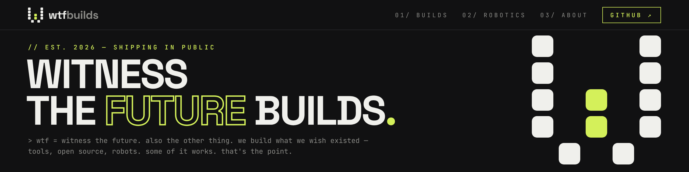
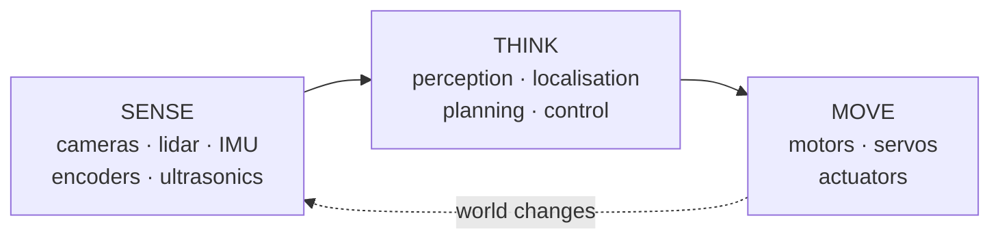

<div align="center">
<a href="https://wtfbuilds.com">
  
</a>
<br>
[](https://wtfbuilds.com)
[](https://wtfbuilds.com)
[](#-wtfbuilds-robotics-society)
[](https://wtfbuilds.com)
 
**[builds](#-currently-shipping) · [robotics society](#-wtfbuilds-robotics-society) · [join](#-join-the-crew) · [rules](#-ground-rules)**
 
</div>
---
 
## `// who we are`
 
> **wtf = witness the future.** also the other thing.
 
we build what we wish existed: tools, open source, robots.
some of it works. that's the point.
 
est. 2026 · shipping in public · from bareilly, india.
 
---
 
## `// currently shipping`
 
| # | build | what it is | status |
|---|-------|-----------|--------|
| 01 | **[wtfbuilds.com](https://wtfbuilds.com)** | our home on the web. every build lives here. |  |
| 02 | **robotics society** | student-run crew building autonomous robots. |  |
| 03 | **your idea** | pitch a build. if it's weird enough, we're in. |  |
 
<!-- add each new repo as a row: | 04 | **[repo-name](link)** | one line |  | -->
 
---
 
## 🤖 wtfbuilds robotics society
 
a student-run society where we design, build and break **autonomous robots**,
and publish every step on the way.
 
**no remote controls. if it moves, it decided to move.**
 
### the loop every robot runs
 

 
### the build ladder
 
we start small and level up. every rung is a real robot with its own repo.
 
| level | robot | what you learn |
|-------|-------|----------------|
| `L0` | **blink + drive** | microcontrollers, motor drivers, power, wiring |
| `L1` | **line follower** | sensors, PID control, tuning |
| `L2` | **obstacle avoider** | ultrasonic/ToF sensing, reactive behaviour |
| `L3` | **vision rover** | OpenCV, object tracking, camera pipelines |
| `L4` | **mapping bot** | SLAM, localisation, path planning, ROS 2 |
| `L5` | **full autonomy** | mission planning, sensor fusion, field tests |
 
<sub>draft ladder. we'll reshape it with the first crew.</sub>
 
### tracks
 
<details>
<summary><b>perception</b>: see the world</summary>
computer vision, object detection, depth sensing, sensor fusion.
 
</details>
<details>
<summary><b>navigation</b>: know where you are, get where you're going</summary>
mapping, localisation, path planning, obstacle avoidance.
 
</details>
<details>
<summary><b>control</b>: move without falling over</summary>
PID, motor control, state estimation, stability.
 
</details>
<details>
<summary><b>embedded</b>: the brain and the nerves</summary>
firmware, microcontrollers, power systems, communication.
 
</details>
<details>
<summary><b>mechanical</b>: the body</summary>
chassis, drivetrains, 3D-printed parts, wiring harnesses.
 
</details>
<details>
<summary><b>simulation</b>: crash fewer real robots</summary>
test in sim first. virtual worlds, digital twins, automated tests.
 
</details>
### tools we'll reach for
 


 
### how we run
 
1. **pick a build.** every robot gets its own repo and one clear goal.
2. **build in public.** commits, failed experiments and demo videos, all open.
3. **demo day.** if it can't run on its own, it isn't done.
4. **open source it.** code, wiring, CAD and write-ups, so the next team starts further ahead.
---
 
## 🔧 join the crew
 
no gatekeeping. bring code, circuits, CAD, design, docs, or plain curiosity.
 
- 👀 **watch this org** to catch robotics repos as they drop
- 💡 **pitch a robot** in [Discussions](https://github.com/orgs/wtfbuilds/discussions)
- 🐛 **pick up a `good first issue`** in any repo
- 🍴 **fork → branch → PR.** small PRs get merged fastest
<!-- add: Discord / WhatsApp community link, join form, contact email -->
 
<details>
<summary><b>faq</b></summary>
**do i need to know robotics?**
no. start at `L0`. everyone here is learning something.
 
**i only do software / only hardware / only design. still welcome?**
yes. robots need all three.
 
**who can join?**
students first, but good builders are always welcome.
 
**is everything open source?**
that's the default. code, wiring, CAD and write-ups.
 
</details>
---
 
## 📐 ground rules
 
- **ship > talk.** a janky demo beats a perfect plan.
- **document it.** if you built it, write it down.
- **open by default.** share the code, the failures and the wiring diagrams.
- **be kind.** everyone here is learning something.
---
 
<div align="center">
```text
SCROLL                28.38°N, 79.43°E — BAREILLY, IN                STATUS: ONLINE
```
 
**[wtfbuilds.com](https://wtfbuilds.com)** · **[github.com/wtfbuilds](https://github.com/wtfbuilds)**
 
<sub>witness the future builds.</sub>
 
</div>
 