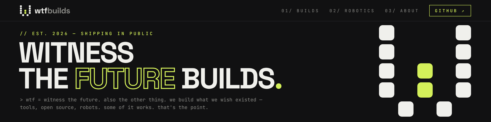

<!-- WTFBUILDS — GitHub Organization Profile -->

<a href="https://wtfbuilds.com">
  
</a>

<p align="center">
  <code>EST. 2026</code> &nbsp;·&nbsp; <code>SHIPPING IN PUBLIC</code> &nbsp;·&nbsp; <code>BAREILLY, IN</code>
</p>

<p align="center">
  <strong>We build what we wish existed.</strong>
  <br />
  Tools. Open source. Software. Robots.
  <br />
  Some of it works. That's the point.
</p>

<p align="center">
  <a href="https://wtfbuilds.com">WEBSITE</a> &nbsp;·&nbsp;
  <a href="https://github.com/wtfbuilds">GITHUB</a>
</p>

---

## `01 / WHAT IS WTFBUILDS?`

WTFBUILDS stands for **Witness The Future Builds.**

We're an independent technology and innovation collective exploring ideas, building unconventional products, and experimenting with technology.

We don't believe every idea needs a pitch deck, a funding round, or a hundred-page business plan.

Sometimes you just need to build the damn thing.

From software platforms and AI-powered tools to robotics, gaming infrastructure, and open-source experiments — we build because we're curious about what can exist.

## `02 / THE BUILDS`

A collection of products, experiments, and things we're bringing to life.

| PROJECT | WHAT IT IS | STATUS |
|:---|:---|:---:|
| **InvertisPrep** | Academic ecosystem for university students | LIVE |
| **AI Resume Builder** | AI-powered resume creation platform | BUILDING |
| **Melon** | Rust-powered Minecraft arcade server engine | BUILDING |
| **Line Follower** | Autonomous robotics experiment | BUILDING |
| **Robotic Arm MK1** | Robotic arm prototyping | EXPERIMENTAL |
| **Untitled OSS 01** | Open-source experiments | EXPLORING |

*Projects evolve. Some ship, some break, some get rebuilt. That's part of the process.*

## `03 / WHAT WE EXPLORE`

**// SOFTWARE & SYSTEMS**

Web platforms, developer tools, SaaS products, backend infrastructure, and scalable systems.

**// ARTIFICIAL INTELLIGENCE**

AI-powered applications, intelligent agents, automation, and experimental workflows.

**// ROBOTICS & HARDWARE**

Embedded systems, sensors, actuators, autonomous machines, and physical prototypes.

**// GAMING & INFRASTRUCTURE**

Game server engines, hosting infrastructure, performance optimization, and gaming technology.

**// OPEN SOURCE**

Useful tools, experimental repositories, developer utilities, and community-driven projects.

## `04 / THE PHILOSOPHY`

```text
01. BUILD WHAT YOU WISH EXISTED.
02. EXPERIMENT WITHOUT PERMISSION.
03. BREAK THINGS. UNDERSTAND WHY.
04. SHIP BEFORE YOU OVERTHINK.
05. OPEN SOURCE WHEN POSSIBLE.
06. LEARN BY BUILDING.
07. BUILD TOGETHER.
```

We value execution over empty conversations, curiosity over credentials, and working prototypes over imaginary billion-dollar ideas.

## `05 / BUILD WITH US`

We're looking for individuals who:

- Are ridiculously curious about technology.
- Have ideas they actually want to execute.
- Enjoy experimenting with unconventional solutions.
- Want to contribute to real products and open-source projects.
- Prefer building something over talking endlessly about building something.

Developers. Engineers. Designers. Researchers. Makers.

You don't need to know everything. You just need to be willing to learn, experiment, and ship.

**Interested in building with us?**

Explore our projects, check out our repositories, and get involved.

<p align="center">
  <a href="https://wtfbuilds.com">wtfbuilds.com</a>
  <br /><br />
  <strong>DON'T JUST WITNESS THE FUTURE. BUILD IT.</strong>
</p>

---

<p align="center">
  <sub>WTFBUILDS © 2026 — BUILT BY CURIOSITY. POWERED BY EXECUTION.</sub>
</p>
